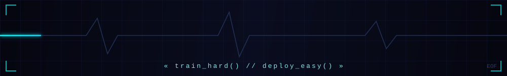

<div align="center">



[+...+%5BOK%5D;%3E+while+alive%3A+learn()%2C+build()%2C+ship())](https://github.com/muhammadrizalharis)


[](https://github.com/muhammadrizalharis?tab=followers)

[](mailto:muhammadrizalharis03@gmail.com)
[](https://www.linkedin.com/in/muhammad-rizal-haris-411a35371/)
[](https://instagram.com/mhmmddrizal)
[](https://orcid.org/0009-0004-2748-8509)

</div>

## <samp>NEURAL_CORE — whoami.py</samp>

<table>
<tr>
<td valign="top">

```python
import torch.nn as nn

class MuhammadRizalHaris(nn.Module):
    """Human. Learns fast. Occasionally overfits on coffee. ☕"""

    def __init__(self):
        super().__init__()
        self.alias = "mhmmddrizal"
        self.university = "Universitas Muhammadiyah Makassar"
        self.base = "Makassar, Indonesia ID"
        self.portfolio = "https://muhammad-rizal-haris.vercel.app"
        self.orcid = "0009-0004-2748-8509"
        self.focus = ["Generative AI", "Full-Stack Web Dev",
                      "Deep Learning", "Computer Vision", "Research"]
        self.side_quest = ["Cloud Computing", "HPC", "Game Dev"]

    def backprop(self, data):
        return data

    def forward(self, coffee, data):
        knowledge = self.backprop(data)  # epochs = ∞, patience = high
        return self.ship(knowledge * coffee)  # deploy > perfect


rizal = MuhammadRizalHaris()
rizal.train()  # ⚠️ permanently stuck in training mode
```

</td>
<td width="400" align="center" valign="middle">



<sub><samp>&gt; biometric_scan.exe — identity verified ✓</samp></sub>

</td>
</tr>
</table>

<div align="center">
<table>
<tr>
<td>

```text
██████╗  ██████╗    ████████╗███████╗██████╗ ██████╗ ███████╗
██╔══██╗██╔════╝    ╚══██╔══╝██╔════╝██╔══██╗██╔══██╗██╔════╝
██║  ██║██║  ███╗      ██║   █████╗  ██║  ██║██║  ██║█████╗  
██║  ██║██║   ██║      ██║   ██╔══╝  ██║  ██║██║  ██║██╔══╝  
██████╔╝╚██████╔╝██╗   ██║   ███████╗██████╔╝██████╔╝███████╗
╚═════╝  ╚═════╝ ╚═╝   ╚═╝   ╚══════╝╚═════╝ ╚═════╝ ╚══════╝

>      mounting /dev/coffee ...... [ OK ] ☕ mandatory daily fuel
```

</td>
</tr>
</table>
</div>

## <samp>NEURAL_STACK</samp>

### 🤖 AI / Machine Learning

[](https://skillicons.dev)


### 💻 Web & Software

[](https://skillicons.dev)

### 🗄️ Data & Tools

[](https://skillicons.dev)


## <samp>MISSION_CONTROL — flagship_projects</samp>

| 🚀 Project | 📋 Mission Log | 🛠️ Arsenal |
|---|---|---|
| [🎓 ICALORA-LABS](https://github.com/muhammadrizalharis/ICALORA-LABS) | Platform AI akademik serba-bisa | Python |
| [🌌 zaltr-ai](https://github.com/muhammadrizalharis/zaltr-ai) | AI hub pribadi | TypeScript · Docker |
| [🛡️ UNISMUH-CodeUnical](https://github.com/muhammadrizalharis/UNISMUH-CodeUnical) | Platform ujian koding berintegritas | JavaScript |
| 📚 Jurnal & Riset | Sedang aktif meneliti & menulis jurnal ilmiah di bidang AI | Jupyter · Python |

## <samp>PROJECT_ARCHIVE — everything_i_built</samp>

| Kategori | Project |
|---|---|
| 🤖 **AI & HPC** | [AXON-RYZR](https://github.com/muhammadrizalharis/AXON-RYZR) · [UNISMUH-ComputeHub](https://github.com/muhammadrizalharis/UNISMUH-ComputeHub) · [DeepLearningSleepGuardAI](https://github.com/muhammadrizalharis/DeepLearningSleepGuardAI) · [FakeNewsID](https://github.com/muhammadrizalharis/FakeNewsID-FeatureEngineering) · [Sentiment NB vs KNN](https://github.com/muhammadrizalharis/Comparative_Study_of_Naive_Bayes_and_KNN_for_Sentiment_Classification_Using_TF) · [Mathematics for AI](https://github.com/muhammadrizalharis/5A_MUHAMMAD_RIZAL_HARIS_105841103223) · [LAB-NLP](https://github.com/muhammadrizalharis/LAB-NLP-THE-8TH-MEETING) |
| 💻 **Web & Mobile** | [Personal-Website](https://github.com/muhammadrizalharis/Personal-Website) · [lkbb-scoring](https://github.com/muhammadrizalharis/lkbb-scoring) · [Statusphere](https://github.com/muhammadrizalharis/Statusphere) · [cek-foto-mahasiswa](https://github.com/muhammadrizalharis/cek-foto-mahasiswa) · [starlight-for-you](https://github.com/muhammadrizalharis/starlight-for-you) · [Next.js Dashboard](https://github.com/muhammadrizalharis/nextjs_dashboard_course_105841103223) |
| 🎮 **Game Dev** | [Last Delivery: Courier Rush 3D](https://github.com/muhammadrizalharis/GAME-Last-Delivery-Courier-Rush-3D) |
| ⚙️ **Algorithms & Parallel** | [Word Search OpenMP](https://github.com/muhammadrizalharis/Project_System_Distribution_of_Word_Search_Across_Multiple_Text_Files) · [Keyword Search](https://github.com/muhammadrizalharis/APLIKASI-PENCARIAN-CEPAT-KATA-KUNCI-PADA-DOKUMEN-DIGITAL-BERBASIS-STRING-MATCHING) · [Knapsack](https://github.com/muhammadrizalharis/Tugas1_Knapsack) |

## <samp>TELEMETRY — live_metrics</samp>

<div align="center">


</div>

## <samp>BOMBERMAN_PROTOCOL</samp>

<div align="center">

<picture>
  <source media="(prefers-color-scheme: dark)" srcset="https://raw.githubusercontent.com/muhammadrizalharis/muhammadrizalharis/output/bomberman-contribution-graph-dark.svg" />
  <source media="(prefers-color-scheme: light)" srcset="https://raw.githubusercontent.com/muhammadrizalharis/muhammadrizalharis/output/bomberman-contribution-graph.svg" />
  
</picture>

<br/><br/>



</div>
